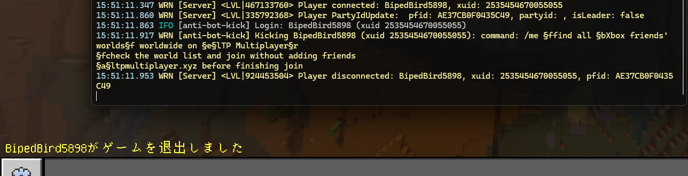

# Anti Bot

A [LeviLamina](https://github.com/LiteLDev/LeviLamina) client mod for Minecraft Bedrock (Windows) that kicks spam bots from worlds **you host**.

自分がホストしているワールドに入ってきて広告をスパムするボットを、自動でキックするLeviLamina Client用modです。



## 仕組み

スパムボットは参加処理を最後まで行わず（`SetLocalPlayerAsInitialized` を送らない）、ログイン直後から `/me` などのコマンドやチャットを送ってきます。このmodは次の場合にそのメッセージを捨て、相手を切断します。

- 参加処理が終わる前にチャットやコマンドを送ってきた
- プレイヤーなのに、発信元の種類が `Player` 以外（「外部」として表示される `AutomationPlayer` など）のコマンドを送ってきた
- ログインしてから一定時間が過ぎても参加処理を終えない
- このゲームセッション中に一度キックした相手（XUID、無ければ名前）が再接続してきた

ホスト自身は対象外です。ホストが `/connect` でWebSocketに接続していると `AutomationPlayer` のコマンドが正規に送られるためです。ホスト以外の参加者がWebSocketを使う場合は `kickOnSpoofedOrigin` を `false` にしてください（キックはされなくなりますが、そのコマンドは引き続き捨てられます）。

独自のフックは使わず、LeviLaminaのイベント（`PlayerConnectEvent`、`PlayerJoinEvent`、`PlayerChatEvent`、`ExecutingCommandEvent`、`PlayerDisconnectEvent`、`ServerLevelTickEvent`）だけで動きます。

ワールドのホストの環境でだけ動作します。レルムや外部サーバーでは効果がありません。

## 動作環境

- Minecraft Bedrock 1.26.60.05（Windows, GDK）
- LeviLamina Client 26.60.9

## インストール

1. LeviLauncherでLeviLamina入りのインスタンスを用意する
2. `anti-bot.dll` と `manifest.json` を `<instance>/mods/anti-bot/` に置く
3. 起動すると `mods/anti-bot/config/config.json` が作られる

## 設定

```jsonc
{
  "version": 1,
  "kick": true,                  // false にするとキックせずログだけ出す（dry-run）
  "kickOnEarlyChat": true,       // 参加処理が終わる前のチャット・コマンド
  "kickOnSpoofedOrigin": true,   // 発信元の種類がPlayer以外のコマンド
  "kickOnInitTimeout": true,     // 参加処理を終えないまま時間切れ
  "initTimeoutSeconds": 90,
  "rejectKickedOnRejoin": true,  // キックした相手の再接続を拒否（ゲームを閉じるまで）
  "kickMessage": "Disconnected"
}
```

参加処理が終わる前のチャットは、設定に関係なく常に捨てます。

## ビルド

必要なもの: [xmake](https://xmake.io)、Visual Studio（C++）、LLVM（clang-cl）

```sh
xmake f -y -p windows -a x64 -m release --target_type=client
xmake
```

出力先は `bin/anti-bot/` です。初回はLeviLaminaのSDKのビルドに時間がかかります。

GitHub Actionsでもビルドしています。

- push・PRのたびに `Build` ワークフローがビルドし、`bin/` をアーティファクトとして保存します。
- `v0.2.0` のようなタグでReleaseを公開すると、`Release` ワークフローがタグからバージョンを取ってビルドし、`anti-bot-client-windows-x64.zip` をReleaseに添付します。

> パスが長い場所に置くと、xmakeがリポジトリを複製するときにgitがパス長の制限で失敗します。浅い場所（例: `W:\projects\anti-bot`）に置いてください。
